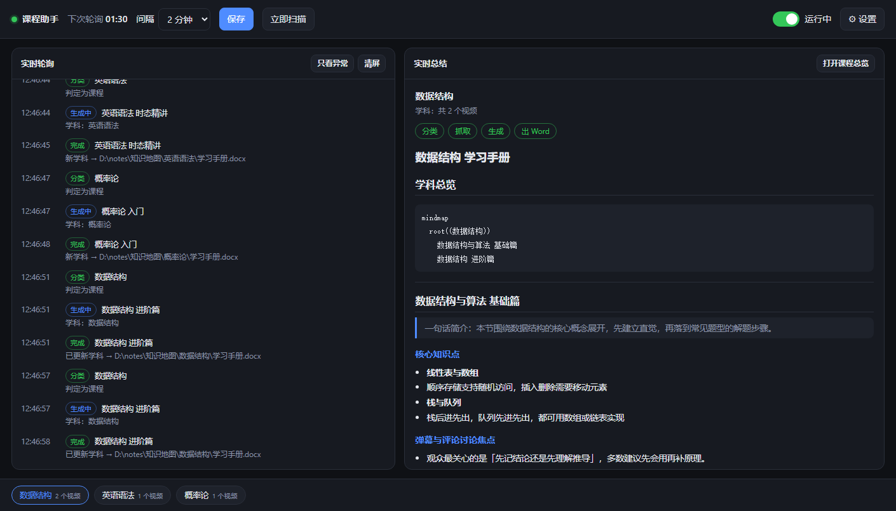
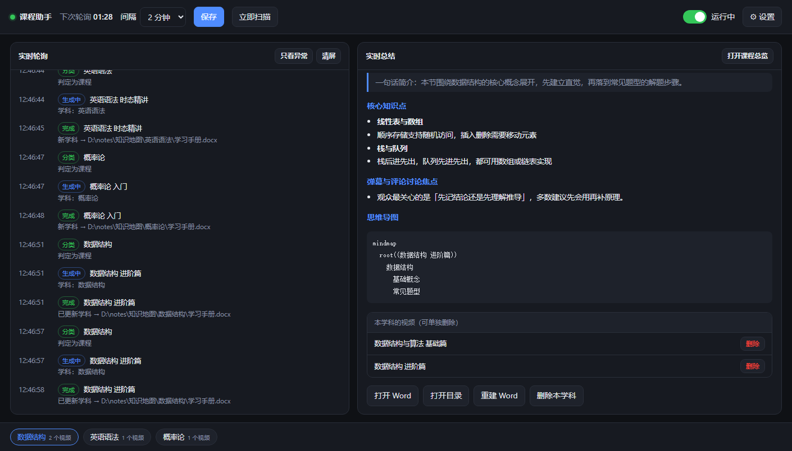

# 课程助手 · B 站课程实时知识地图

> 看课时自动把课程变成结构化笔记：识别前台视频 → 判断学科 → 抓简介/字幕/弹幕/热评 → 生成知识地图 → 导出 Word。



Windows 本地应用（独立运行）+ 一组 DeepSeek Harness 插件（可选）。核心只有一句话：
**把 B 站课程视频放在前台 20 秒，笔记自己长出来。**

- 不需要浏览器扩展，不需要 CDP，不开 DSH 也能用
- 只在你真的在看课时动手；同一个视频看第二遍不会重复记录
- 输出的是一份能直接复习的 Word，而不是一堆散落的 AI 回答

---

## 1. 这个项目解决什么问题

**看网课最大的浪费是「看完了、没留下」。** 手动记笔记嫌打断节奏，事后补又全忘光了。

这个项目把「看课 → 留下可复习的东西」这段流程自动化，且只做这一件事：

1. **发现**：轮询 Windows 前台窗口标题，识别你正在看的视频（浏览器 / B 站客户端均可）
2. **判类**：让模型判断这是不是有知识含量的内容、属于哪个学科（不是就静默跳过）
3. **取证**：按标题反查 B 站，抓这个视频的简介、标签、字幕（如有）、弹幕、热评
4. **总结**：基于上面这些**真实内容**（而不是凭空想象）生成知识点与思维导图
5. **归档**：追加进对应学科的学习手册，导出为 Word

它明确**不做**的事（也是设计取舍）：

- 不做视频转写：大部分课程没有机器字幕，字幕抓不到就降级为「简介 + 弹幕 + 评论」
- 不接管播放、不做书签、不做字幕翻译
- 不依赖云端账号：笔记全部落在你本地的一个文件夹里

## 2. 主要功能

| 功能 | 具体行为 |
| --- | --- |
| **实时检测** | 每 10 秒读一次前台窗口（进程名 + 标题）；白名单含 Edge / Chrome / 360 / QQ / 搜狗 / B 站客户端 等；标题先清洗再判定 |
| **防误触** | 连续 2 次（可调）看到同一标题才处理；窗口切走就重新计数 |
| **去重静默** | 处理过的标题进 `seen` 表，再看第二遍不产生任何动作 |
| **学科分类** | 模型输出 `isCourse / subject / keywords`；已有学科 → 追加，新学科 → 自动新建手册 |
| **内容抓取** | 搜索前 12 条取相似度最高（阈值 0.35）→ 视频信息、弹幕 ≤150 条、热评（代码上限 20 条，匿名接口实际约 3 条）、字幕尽力抓取 |
| **知识总结** | 8~20 条核心知识点（2~3 层）+ 弹幕/评论讨论焦点 + Mermaid 思维导图 |
| **Word 导出** | python-docx 生成；Mermaid mindmap 渲染成 Word 原生分级大纲；每次生成同步重建《课程总览.docx》 |
| **控制台** | 轮询间隔可调（2s–300s，保存即生效）、一键启停、实时轮询事件流、生成过程流式预览、笔记库、按章/按学科删除、重建 Word |
| **双入口** | 独立桌面应用；也可作为 DSH 插件，在会话里用工具驱动 |
| **降级可用** | 没有模型 Key 时仍能检测、记录、浏览已有笔记（只是不生成新内容） |

### 工作原理

```
前台窗口  (user32!GetForegroundWindow + GetWindowText)
   │  PowerShell 读标题/进程名，先写临时文件再读（规避中文编码问题）
   ▼
cleanTitle()   剥掉「_哔哩哔哩_bilibili - 用户配置 1 - Microsoft Edge」这类尾巴
   ▼
seen 去重表 ──命中──► 静默，什么都不发生
   │ 未命中
   ▼
连续 N 次标题稳定 ──► LLM 分类 ── 非课程 ──► 记 seen，静默
   ▼
B 站搜索反查（前 12 条取最优，阈值 0.35）
   ├─ 视频信息（简介 / 标签 / UP 主）
   ├─ 弹幕 XML（≤150 条）
   ├─ 热评（匿名接口上限 3 条）
   └─ 字幕（有则抓，无则跳过）
   ▼
LLM 生成 Markdown + Mermaid ──► 追加到 <学科>/学习手册.md
   ▼
python-docx 转换 ──► <学科>/学习手册.docx ＋ 课程总览.docx
```

一份核心代码两个入口共用，靠 `<outputDir>/.state/lock.json` 进程锁互斥：

```
app/server.mjs（HTTP + SSE + 定时调度）──────────────┐
                                                     ├──► plugins/dsh-video-coursemap/lib/core/pipeline.mjs
plugins/dsh-video-coursemap/lib/index.js（DSH）──────┘
        ▲
   模型适配器：独立应用走 OpenAI 兼容 HTTP；DSH 里走 ctx.llm
```

## 3. 安装方法

### 前置条件

| 依赖 | 要求 | 说明 |
| --- | --- | --- |
| Windows | 10 / 11 | 前台窗口检测依赖 user32，暂无跨平台计划 |
| Node.js | ≥ 18（开发用 24） | 运行服务与插件 |
| Python | 3.x + `python-docx` | **只用于出 Word**；没有也能跑，只是不生成 docx |

```powershell
pip install python-docx
```

### 方式 A：独立应用（推荐，不需要 DSH）

```powershell
git clone https://github.com/<you>/course-notes.git 课程助手
cd 课程助手
copy config.example.json app\config.json
node app\server.mjs
```

看到这行就成功了：

```
[课程助手] 已启动 http://127.0.0.1:3456  输出目录 C:\Users\<你>\课程知识地图
```

浏览器打开 <http://127.0.0.1:3456> → 右上「⚙ 设置」填模型（baseUrl / model / API Key），点「测试连接」通过即可。

**做成桌面快捷方式**（可选）：给 `app\start.vbs` 建快捷方式，目标填
`wscript.exe "…\app\start.vbs"`，图标选 `app\icon.ico`。脚本会先探测服务是否在跑：在跑就只开浏览器，没跑就无窗口启动。

### 方式 B：作为 DSH 插件

```powershell
dsh plugin --profile <profile> add <repo>/plugins/dsh-video-coursemap
dsh plugin --profile <profile> add <repo>/plugins/dsh-course-notes
```

然后在 profile 的 `cordis.patch.yml` 里配置（详见 [docs/dsh-plugin.md](docs/dsh-plugin.md)）：

```yaml
- id: dsh-video-coursemap
  name: "dsh-video-coursemap"
  config:
    outputDir: 'D:/notes/知识地图'
    pollIntervalMs: 10000
    stablePolls: 2
    fetchContent: true
    enabled: true
```

### 安装常见问题

| 现象 | 原因 / 处理 |
| --- | --- |
| 打开 3456 是别的页面，或页面打不开 | 端口被占，服务会自动顺延到 3457 / 3458 / 3459（启动日志会再打一行「已启动」）；实际端口也写在 `app/runtime.json` |
| 生成时 `DOCX_FAILED` | 找不到带 python-docx 的 Python。`pip install python-docx` 后重启应用 |
| 检测一直是「非浏览器」 | 你在用的浏览器不在白名单（如部分国产壳浏览器），见「已知限制」 |
| 设置里填了 Key 仍报 401 | 用「测试连接」先验证；多数是 baseUrl 少了 `/v1` 或 Key 填错 |

## 4. 使用方法

### 日常：三步

1. 用浏览器（或 B 站客户端）打开课程视频
2. **让这个窗口在前台连续停留约 20 秒**（默认 10 秒轮询 × 2 次稳定）
3. 什么都不用做。左栏事件流会依次出现 `分类 → 抓取 → 生成 → 完成`，右栏流式显示正在写的内容

### 控制台各控件

| 控件 | 作用 |
| --- | --- |
| 顶栏状态灯 + 倒计时 | 绿 = 运行中；倒计时是下一轮的时间 |
| 「间隔」下拉 + 保存 | 3 秒 ~ 2 分钟；自定义值保存后会留在下拉里；**保存即重建定时器** |
| 启动 / 停止开关 | 只停轮询，服务不停；状态持久化到 `config.json` |
| 「立即扫描」 | 立刻处理当前前台窗口（不等稳定计数），也**绕过去重表**，适合重做单个视频 |
| 左栏「实时轮询」 | 每次观测一行；「只看异常」过滤噪音 |
| 右栏「实时总结」 | 四步进度 + 流式输出 + 完成后的 Markdown 预览 |
| 底部笔记库 | 点学科 chip 查看整本手册 |
| 详情页底部 | 打开 Word / 打开目录 / 重建 Word / **按视频删除** / **删除本学科** |



### 在 DSH 会话里用（方式 B）

| 你对助手说 | 实际调用 |
| --- | --- |
| 「看看现在的状态」 | `course_map_status` |
| 「扫描一下当前视频」 | `course_map_scan` |
| 「投递课程笔记」 | `course_notes_inbox` → `course_notes_deliver` → `present`（文件卡片出现在对话框） |

### 删除笔记

界面上：点开学科 → 右栏底部 → 「删除」某一章，或「删除本学科」（均二次确认，Word 自动重建）。

命令行（应用没开也能用）：

```powershell
node app\tools\delete-subject.mjs --list
node app\tools\delete-subject.mjs "办公软件" --yes              # 连去重条目一起删
node app\tools\delete-subject.mjs "办公软件" --yes --keep-seen  # 保留去重（以后看同一视频仍静默）
```

### 出了问题看这里

`.state\poll.log` 是最重要的排查入口：

| 日志内容 | 含意 |
| --- | --- |
| `fg proc=... title=...` | 本轮读到的前台窗口（所有进程都记） |
| `browser proc=msedge cleaned="..."` | 判定为白名单浏览器，且标题清洗成功 |
| `verdict=pending stable=1/2` | 新标题，等待第 2 次确认 |
| `verdict=seen` / `not-course` | 已处理过 / 模型判定非课程，静默 |
| `bili bvid=... danmaku=.. comments=..` | 抓取结果；`bvid=none` 表示标题反查没匹配到视频 |
| `error code=... msg=...` | 具体失败环节（DOCX_FAILED / LLM_AUTH / BILI_FAILED…） |

## 5. 输入输出示例

### 输入

**输入端只有两样东西**：前台窗口标题（连同它的进程名）和你配置的模型。

示例（Edge 多 profile 下的标题，中间夹着零宽字符；下列标题均为演示数据）：

```text
数据结构与算法 基础篇_哔哩哔哩_bilibili - 用户配置 1 - Microsoft​ Edge
```

清洗后：

```text
数据结构与算法 基础篇
```

对应的日志时间线（摘自 `.state/poll.log`，时间已简化）：

```text
15:47:59  fg proc=msedge title="数据结构与算法 基础篇_哔哩哔哩_bilibili - 用户配置 1 - Microsoft​ Edge"
15:47:59  browser proc=msedge cleaned="数据结构与算法 基础篇"
15:48:29  browser proc=msedge cleaned="数据结构与算法 基础篇"     ← 第 2 次，判定稳定
15:48:30  classify title="数据结构与算法 基础篇" subject=数据结构 isCourse=true
15:48:32  bili bvid=BV1xx411c7mD danmaku=23 comments=3
15:48:39  done subject=数据结构 title="数据结构与算法 基础篇" docx=ok
```

也可以不用窗口，直接给标题（等价的手动入口）：`course_map_scan {title:"英语语法 时态精讲"}`，或页面上的「立即扫描」。

### 输出

**一个目录，两类文档。** 以 `C:\Users\<你>\课程知识地图` 为例：

```text
课程知识地图/
├── 课程总览.docx                 # 全局：学科总览 mindmap + 学科列表
├── 数据结构/
│   └── 学习手册.docx             # 该学科每看一个视频追加一节
├── 英语语法/
│   └── 学习手册.docx
└── .state/
    ├── state.json               # subjects（学科→视频）＋ seen（去重表，上限 500）
    ├── manuals/数据结构.md       # Word 的 Markdown 源（可直接改）
    ├── manuals/index.md         # 课程总览的源
    ├── lock.json                # 进程锁（谁在轮询）
    └── poll.log                 # 观测 / 分类 / 抓取日志
```

**《数据结构/学习手册.docx》示例节选**（运行截图里那一次生成的产物）：

```markdown
## 数据结构与算法 基础篇

> 一句话简介：本节围绕数据结构的核心概念展开，先建立直觉，再落到常见题型的解题步骤。

### 核心知识点

- **线性表与数组**
  - 顺序存储支持随机访问，插入删除需要移动元素
- **栈与队列**
  - 栈后进先出，队列先进先出，都可用数组或链表实现

### 弹幕与评论讨论焦点

- 观众最关心的是「先记结论还是先理解推导」，多数建议先会用再补原理。
```

实际生成时，这一节里的知识点与讨论焦点来自抓取到的**简介 / 字幕 / 弹幕 / 热评**，不是凭空编的（抓不到就降级为基于标题的通用总结，见下文）。

Word 里「思维导图」一节会把 Markdown 中的 Mermaid mindmap 渲染成**原生分级大纲**（根节点加粗、逐级缩进的项目符号），而不是一段代码。

**《课程总览.docx》** 每次生成后自动重建：所有学科的总览 mindmap + 学科列表（每个学科几个视频、对应哪本手册）。

### 两种「正常但看起来没动」的情况

| 情况 | 表现 | 为什么 |
| --- | --- | --- |
| 同一个视频再看一遍 | 事件流只有「轮询 / 已处理·静默」，不产生新文档 | `seen` 去重表命中 |
| 标题反查不到视频 | 日志 `bvid=none`，手册仍会生成，但只有「基于标题的通用总结」 | 搜索前 12 条相似度都低于 0.35，宁可降级也不编造 |

## 6. 配置项

`app/config.json`（页面上的改动会即时写回，无需重启）：

| 键 | 默认 | 说明 |
| --- | --- | --- |
| `port` | 3456 | 被占用自动顺延（3457–3459） |
| `pollIntervalMs` | 10000 | 轮询间隔，允许 2000–300000 |
| `stablePolls` | 2 | 连续几次稳定才处理，1–10 |
| `titleMinLen` | 4 | 标题短于此长度直接忽略 |
| `fetchContent` | true | 关掉则只按标题总结，不抓弹幕 / 评论 |
| `maxTokens` | 4096 | 单次生成上限 |
| `outputDir` | `%USERPROFILE%\课程知识地图` | 笔记输出目录（两个入口必须一致） |
| `llm.baseUrl` | `https://api.deepseek.com` | 任意 OpenAI 兼容端点；本地 Ollama 填 `http://127.0.0.1:11434/v1` |
| `llm.model` | `deepseek-chat` | 模型名 |
| `llm.apiKey` | 空 | 空 = 只检测不生成；**该文件已在 .gitignore 中，不会提交** |

## 7. HTTP API（供二次开发）

| 方法 | 路径 | 说明 |
| --- | --- | --- |
| GET | `/api/status` | 运行状态、学科、文档、锁、模型配置（不回传 Key 明文） |
| POST | `/api/config` | 部分更新配置；非法值返回 400 + errors |
| POST | `/api/scan` | `{title?}` 立即扫描 |
| GET | `/api/events` | SSE：tick / decision / classify / fetch / generate-start / token / generate-done / error |
| GET | `/api/notes`、`/api/notes/:subject` | 文档清单 / 学科 Markdown + 视频章节 |
| POST | `/api/notes/:subject/rebuild` | 按 md 重建 Word |
| POST | `/api/notes/:subject/delete-video` | `{title}` 删除单个视频章节 |
| POST / DELETE | `/api/notes/:subject(/delete)` | 删除整个学科 |
| POST | `/api/rebuild` | 全量重建 |
| GET | `/api/log?tail=200` | poll.log 尾部 |
| POST | `/api/open` | 打开输出目录内文件（越界路径拒绝） |
| POST | `/api/llm/test` | 试调模型 |
| POST | `/api/seen/reset` | 清空去重表 |
| POST | `/api/shutdown` | 退出服务 |

## 8. 已知限制

- **只有标题，没有 URL**：检测通道是窗口标题，所以内容靠标题反查，同名不同 UP 的视频可能匹配错（日志里 `matchScore` 可核对）。
- **必须真在前台**：后台播放、最小化、窗口被切走都不触发（这是「不误判」的代价）。
- 弹幕依赖 `comment.bilibili.com/{cid}.xml`，课程类视频本身弹幕可能为 0（接口没问题，热门视频实测单视频 7200 条）。
- 匿名评论接口最多返回 3 条热评；多数课程没有机器字幕。
- 浏览器白名单见 `plugins/dsh-video-coursemap/lib/core/title.mjs`（Edge / Chrome / Firefox / 360 / QQ / 搜狗 / B 站客户端…），不在名单里的浏览器需要自行加进程名。
- 仅支持 Windows。

## 9. 开发与测试

```powershell
node --check app\server.mjs      # 语法
node tests\run.mjs               # 29 项自测（假模型 + 临时目录，不碰真实笔记）
```

测试覆盖：标题清洗（含 Edge 多 profile 与零宽字符）、JSON 容错、完整流水线（分类→生成→docx）、
按章节 / 按学科删除、进程锁互斥。

约定：

- 改 `lib/core/*` 后，独立应用重启即可生效；**DSH 插件必须重启 DSH**（ESM 模块缓存，换目录重装也绕不过）
- 只改 `config.json` 时，页面保存即热生效
- `scripts/md2docx.py` 是 Markdown → Word 的唯一出口

## 10. 许可

本项目以 [MIT](LICENSE) 许可发布 —— 可商用、可修改、可再分发，保留版权声明即可。

Copyright (c) 2026 pyyrr

- 第三方组件与本项目的修改说明：[THIRD-PARTY-NOTICES.md](THIRD-PARTY-NOTICES.md)
- `plugins/dsh-video-coursemap` 来自上游 MIT 项目，其原始许可见 [plugins/dsh-video-coursemap/LICENSE](plugins/dsh-video-coursemap/LICENSE)

## Roadmap

- [ ] 用浏览器扩展 / CDP 拿 URL 与 BV 号，替代标题反查
- [ ] 同一视频增量更新（只补新弹幕与热评）
- [ ] 周报：把一周的学习手册汇总成复习提纲
- [ ] 打包成免 Node 的独立 exe
