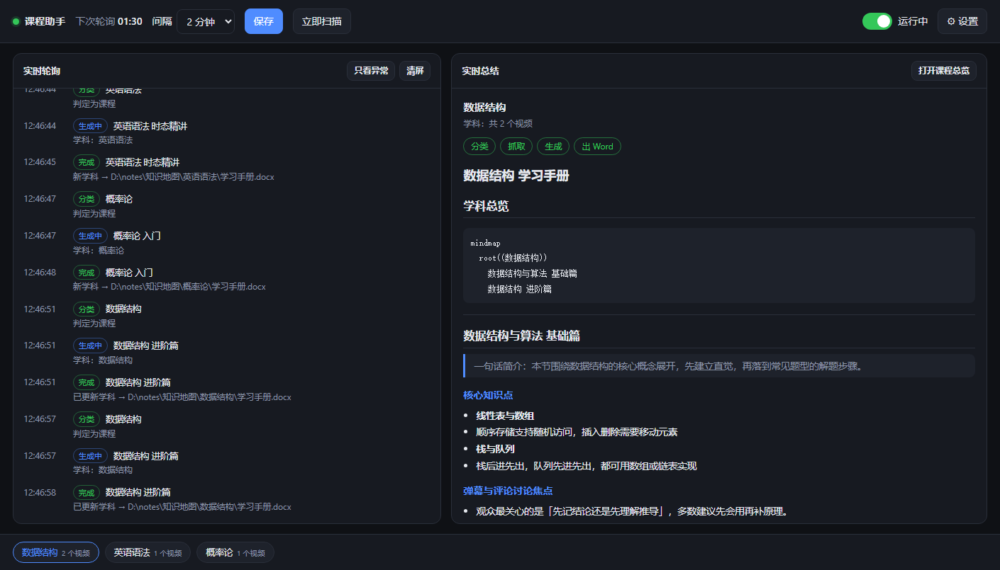
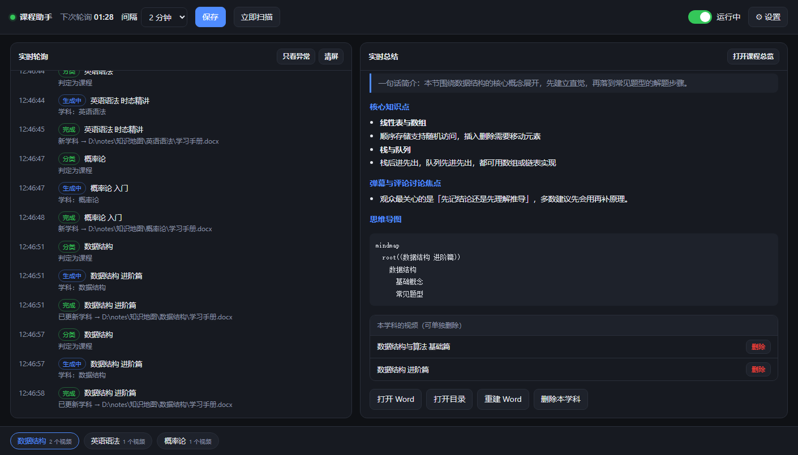

# 课程助手（独立应用）

B 站课程实时笔记的本地控制台：**不用打开 DeepSeek Harness**，双击桌面「课程助手」即可。



## 启动

- 桌面快捷方式 **课程助手**（`C:\Users\一 一\Desktop\课程助手.lnk`）：
  已在运行 → 直接开浏览器；未运行 → 无窗口启动本地服务再开浏览器。
- 或命令行：`node D:\course-notes\app\server.mjs`
- 默认地址 `http://127.0.0.1:3456`（端口被占用会自动顺延 3457/3458，启动器会自动找到）。

关闭浏览器标签不会停止服务；要退出用页面右上「设置」旁的 `POST /api/shutdown`，或结束 node 进程。

## 界面

| 区域 | 作用 |
| --- | --- |
| 顶栏 | 运行状态灯、下次轮询倒计时、**轮询间隔下拉 + 保存**（2s–300s 立即生效）、立即扫描、**启动/停止开关**、设置 |
| 左栏「实时轮询」 | 每次轮询一行：时间 / 进程 / 原始标题 / 判定（待确认 n/2、已处理·静默、非浏览器、B站首页…）；可「只看异常」「清屏」 |
| 右栏「实时总结」 | 分类 → 抓取 → 生成（流式）→ 出 Word 四步进度；完成后渲染 Markdown，可打开 Word/目录 |
| 底部「笔记库」 | 各学科 chip（视频数），点开看该学科学习手册 |
| 设置抽屉 | 模型 baseUrl / model / API Key、测试连接、稳定次数、清空去重表 |

## 模型

生成笔记需要模型，二选一：

1. DeepSeek 官方 Key：baseUrl 留 `https://api.deepseek.com`，model `deepseek-chat`，填 `sk-...`
2. 任意 OpenAI 兼容端点（本地 Ollama 可填 `http://127.0.0.1:11434/v1`）

没填 Key 时应用照样能检测、记录日志、浏览历史笔记，顶部会显示黄色提示。

## 配置文件 `app/config.json`

```json
{
  "port": 3456,
  "pollIntervalMs": 10000,
  "stablePolls": 2,
  "titleMinLen": 4,
  "enabled": true,
  "fetchContent": true,
  "maxTokens": 4096,
  "outputDir": "D:/course-notes/知识地图",
  "llm": { "baseUrl": "https://api.deepseek.com", "model": "deepseek-chat", "apiKey": "" }
}
```

页面上的改动会即时写回该文件。改完无需重启（服务会自动重建定时器与模型客户端）。

## HTTP API

| 方法 | 路径 | 说明 |
| --- | --- | --- |
| GET | `/api/status` | 运行状态、学科、文档、锁、模型配置（不含 Key 明文） |
| POST | `/api/config` | 部分更新配置，校验失败返回 400 + errors |
| POST | `/api/scan` | `{title?}` 立即扫描 |
| GET | `/api/events` | SSE 事件流（tick/decision/classify/fetch/generate-start/token/generate-done/error） |
| GET | `/api/notes` `/api/notes/:subject` | 文档清单 / 学科 Markdown + 视频章节列表 |
| POST | `/api/notes/:subject/rebuild` | 按 md 重建成 Word |
| POST | `/api/notes/:subject/delete-video` | `{title}` 删除某个视频章节（同步重建 Word） |
| POST/DELETE | `/api/notes/:subject(/delete)` | 删除整个学科（目录+docx+md+state+去重条目） |
| POST | `/api/rebuild` | 重建所有学科的 Word 与课程总览 |
| GET | `/api/log?tail=200` | poll.log 尾部 |
| POST | `/api/open` | 打开输出目录内文件（越界路径拒绝） |
| POST | `/api/llm/test` | 用当前（或临时传入的）配置试调模型 |
| POST | `/api/seen/reset` | 清空去重表 |
| POST | `/api/shutdown` | 退出服务 |

## 删除笔记

界面上点开任意学科 → 右栏底部：

- **本学科的视频**：每个视频一行，点「删除」只移除这一章（md 段落 + state.videos + 去重条目），Word 自动重建
- **删除本学科**：删掉整个学科（目录 / docx / md / state 记录 / 去重条目），并重建《课程总览.docx》
- **重建 Word**：md 与 docx 不一致时手动重转一次



命令行等价操作（应用没开时也能用）：

```powershell
node D:\course-notes\app\tools\delete-subject.mjs --list
node D:\course-notes\app\tools\delete-subject.mjs "办公软件" --yes
node D:\course-notes\app\tools\delete-subject.mjs "办公软件" --yes --keep-seen
```

## 与 DSH 插件的关系

应用与 `plugins/dsh-video-coursemap`（DSH 内插件）**共用同一份核心代码**（`plugins/dsh-video-coursemap/lib/core/*`）和同一个输出目录。

- 应用启动会持有 `知识地图/.state/lock.json` 进程锁；插件每轮轮询前检查，发现锁被别人持有就跳过并记日志。
- 目前 DSH 插件已在 profile 配置里设为 `enabled: false`（应用为主力）。想恢复：把
  `C:\Users\一 一\.dsh\profiles\desktop\cordis.patch.yml` 里 `dsh-video-coursemap` 块内的 `enabled` 改成 `true`，然后执行
  `dsh.cmd plugin --profile desktop add D:\course-notes\plugins\dsh-video-coursemap` 重载。

## 排查

| 现象 | 处理 |
| --- | --- |
| 双击快捷方式没反应 | `node D:\course-notes\app\server.mjs` 手动跑，看控制台报错 |
| 页面能开但不轮询 | 看左栏是否有「跳过」事件（另一个实例持锁）；或顶栏开关是否停止 |
| 一直「非浏览器」 | 前台窗口进程不在白名单（如联想浏览器 SLBrowser）；换成 Edge/Chrome，或把进程名加进 `lib/core/title.mjs` |
| 分类后没有 Word | `ERROR DOCX_FAILED`：Python/python-docx 不可用，Markdown 仍在 `.state/manuals/` |
| 模型报 401 | 设置里 Key 不对；用「测试连接」先验 |

## 目录

```
app/
├── server.mjs            本地服务（HTTP + SSE + 调度）
├── summarizer/openai.mjs OpenAI 兼容模型适配
├── ui/                   单页前端（index.html / app.js / style.css）
├── config.json           运行时配置
├── runtime.json          实际端口与 pid（启动器判重用）
├── start.vbs / start.cmd 启动器
├── make-icon.py          生成 icon.ico
└── icon.ico              快捷方式图标
```
